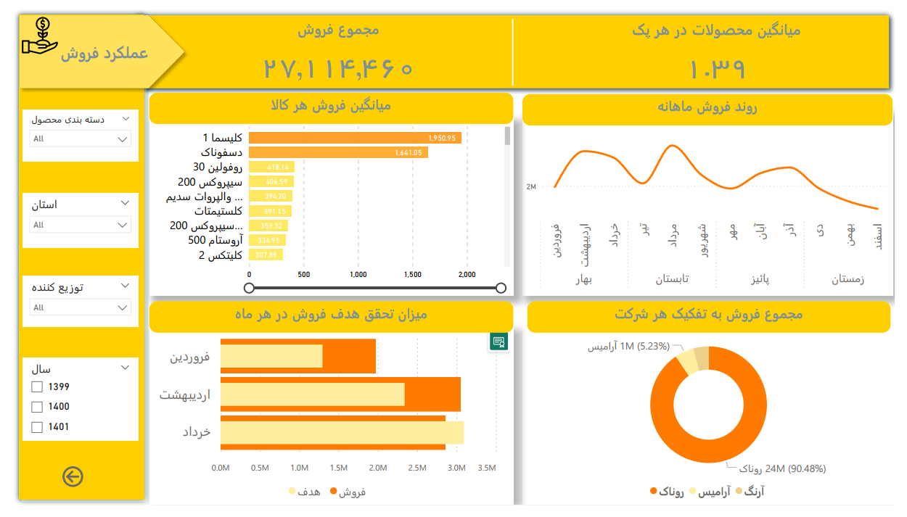

# Pharmaceutical Sales Business Intelligence with Power BI

## Project Overview

This mini-project focuses on analyzing pharmaceutical sales performance and transforming sales data into actionable business insights. Using Microsoft Power BI, I designed an interactive dashboard to explore product sales performance, sales trends over time, target achievement, and the performance of different regions and distributors.

This project was my first experience working with Power BI and applying the concept of **Storytelling from Data**. It helped me move beyond simply presenting numbers and charts toward organizing data in a structured and understandable way to support analysis and business decision-making.

## Project Objectives

- Analyze pharmaceutical product sales performance.
- Examine sales trends across different time periods.
- Compare product sales and identify better-performing products.
- Evaluate sales target achievement.
- Analyze sales performance across different geographical regions.
- Examine the contribution of products and distributors to total sales.
- Provide a clear overview of sales performance through interactive data visualization.

## Dashboard Features

### 1. Product Sales Performance Analysis

Analyze and compare product sales to identify top-performing products and better understand the overall sales mix.

### 2. Sales Trend Analysis

Visualize changes in sales over time and examine monthly sales patterns to identify trends and fluctuations.

### 3. Sales Target Monitoring

Compare actual sales with predefined targets and evaluate target achievement across different periods.

### 4. Regional and Distributor Performance Analysis

Use interactive filters to explore sales performance by province, distributor, and other available data dimensions.

### 5. Interactive Dashboard Design

Use key performance indicators (KPIs), comparative charts, trend visualizations, and interactive filters to facilitate data exploration and analysis.

## Dashboard Preview

### Sales Performance Overview

*This screenshot provides an overview of the dashboard, including key sales indicators, average product sales, monthly sales trends, target achievement, and distributor contributions.*

## Project Documentation

For additional dashboard pages and screenshots, see the complete project documentation:

[View the complete dashboard documentation (PDF)](pharmaceutical-sales-dashboard.pdf)

## Tools and Skills

- **Microsoft Power BI** — Interactive dashboard design and data visualization
- **Data Analysis** — Sales performance analysis and trend identification
- **Data Visualization** — Selecting and designing charts to communicate insights effectively
- **Business Intelligence** — Transforming raw data into actionable business insights
- **Storytelling from Data** — Structuring information and presenting data visually to communicate analytical findings clearly

## Experience and Key Learnings

As my first project using Power BI and Storytelling from Data, this experience introduced me to dashboard design principles, selecting appropriate performance indicators, using different visualization techniques, and organizing information to communicate a coherent story through data.

It was an important starting point in developing my skills in data analysis, business intelligence, and decision-support dashboard design.

## Project Scope and Data Disclaimer

The dataset used in this project has been manipulated for demonstration and portfolio purposes. This repository contains selected dashboard screenshots and the PDF documentation of the project.

